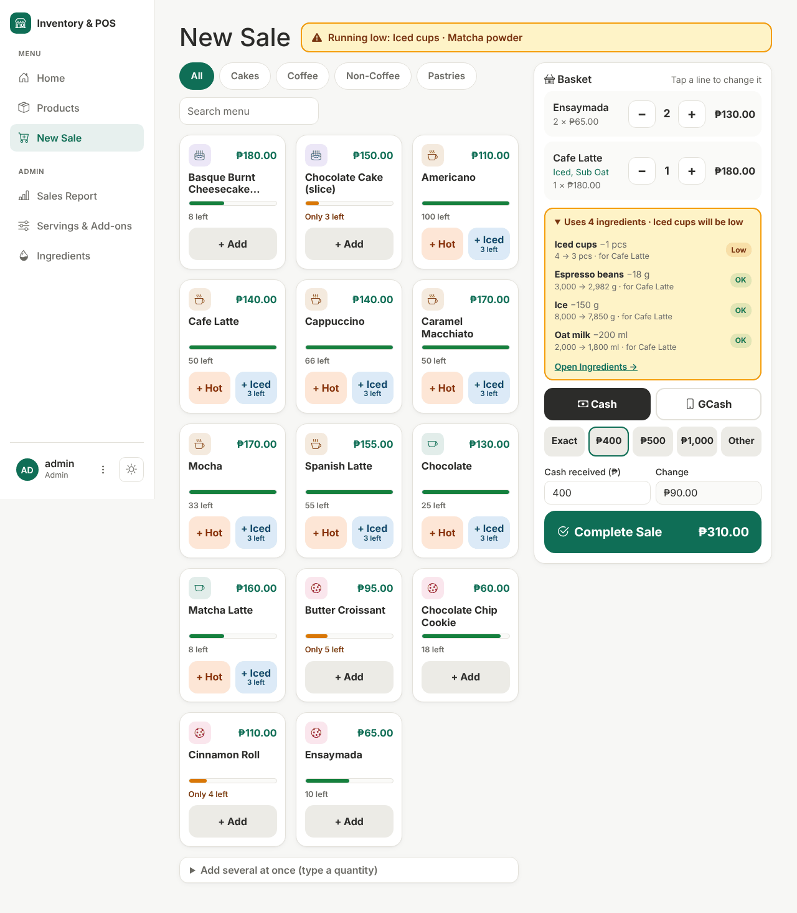

# Inventory & POS System

A web app for a **small café**: it keeps track of products, ingredients and stock, and lets
the cashier sell at the counter and print a receipt. It was built as a university final project
(Software Engineering 1), written in Python with Flask, and it works **without internet**.

Current version: **v0.21.2**



---

## What it does

**Cashiers** (at the counter)

- Sell from a menu of picture tiles: tap **+ Hot** or **+ Iced**. On the basket line, change the
  amount with − / +, or tap the line to choose add-ons.
- Take payment in **cash** (change is worked out for you) or **GCash** (13-digit reference number).
- Print a receipt. A receipt never changes later, even if a product is renamed or its price changes.
- See which items are running low or can't be made because an ingredient has run out.

**Admins** (the owner or manager): everything a cashier can do, plus

- Add, edit and delete products, with a picture, SKU, price, category and stock.
- Set up **servings** (Hot / Iced) and **add-ons** (extra shot, oat milk…) and their prices.
- Manage **ingredients** and **recipes**: each sale uses up the ingredients in its recipe, and the
  app shows how many of each drink can still be made.
- Restock or count ingredients; every change is kept in the ingredient **history**.
- See a **sales report** for any date range: revenue, number of sales, items sold, top products,
  and cash vs GCash.

**Everyone** gets a warm light and dark theme, a sidebar that folds to icons, a profile picture, a change-password page, and pages
that also work on a phone.

## Quick start (Windows)

You need **Python 3.11 or newer** (tested on 3.11 and 3.13) and **Git**, plus internet for the
`pip install` step. Setting up on another computer, such as a school lab, without Git or without
internet? Follow **[docs/run_on_another_computer.md](docs/run_on_another_computer.md)**.

```powershell
# 1. Get the code
git clone https://github.com/JmlAsync/inventory-pos-system.git
cd inventory-pos-system

# 2. Make a virtual environment and install the packages
python -m venv venv
.\venv\Scripts\Activate.ps1
pip install -r requirements.txt
# If PowerShell says "running scripts is disabled", skip Activate.ps1 and put
# .\venv\Scripts\python in front of each command instead, for example:
#   .\venv\Scripts\python -m pip install -r requirements.txt

# 3. Fill the database with a demo café menu, the demo accounts and a week of sales
python seed_demo_data.py

# 4. Start the app
python app.py
```

Then open **http://127.0.0.1:5000** in your browser.

On macOS or Linux, activate the virtual environment with `source venv/bin/activate` instead.

### Demo accounts

| Username | Password | Role |
|---|---|---|
| `admin` | `admin123` | Admin: can change products, ingredients and recipes, and see reports |
| `cashier` | `cashier123` | Cashier: can sell and see receipts |

These passwords are for the demo only. Change them on the **Profile** page before using the app
for real.

### Useful extras

| Command | What it does |
|---|---|
| `python seed_demo_data.py --fresh` | Start again with only the demo data. Your old database is renamed to `instance/inventory_backup_<date-time>.db` first, so nothing is lost. |
| `$env:FLASK_DEBUG = "1"` then `python app.py` | Debug mode while coding (off by default, because it is unsafe on a real network). |
| `$env:SECRET_KEY = "..."` | Use your own secret key. Without it, one is made once and kept in `instance/secret_key.txt`. |

The database is one file, `instance/inventory.db`. When a new version adds columns, the app
upgrades your existing database by itself at start-up; you never have to delete it.

## Running the tests

```powershell
python tests/run_tests.py            # the contract check, then every test file
python tests/run_tests.py sales      # only test files whose name contains "sales"
python tests/run_tests.py -v         # show every PASS line too
```

The tests use only the Python standard library and run in a temporary copy of the project, so
they never touch your real database or pictures. GitHub runs them on every pull request.

## How the project is organised

| Path | What it holds |
|---|---|
| `app.py` | Every page, the checks on every form, start-up and the database upgrade |
| `models.py` | The database tables: products, users, sales, servings and add-ons, ingredients, recipes, ingredient history |
| `templates/` | The HTML pages (`base.html` is the shared layout) |
| `static/css/theme.css` | The custom look, light and dark |
| `static/vendor/` | Bootstrap 5.3.3, Bootstrap Icons 1.11.3 and the Inter font, stored here so nothing loads from the internet |
| `seed_demo_data.py` | Fills the database with demo data |
| `tests/` | Automated tests and the contract check |
| `project_documentation_draft.md` | The full project report: version history, user stories, test cases, defects, requirements and UML |
| `diagrams/` | UML diagrams (PlantUML source and pictures) |
| `docs/` | Other reports and guides: the security audit, running on another computer, preparing for the professor's session |
| `screenshots/` | Screenshots used in the report |

**Built with:** Python 3.11+, Flask 3.1, Flask-Login, Flask-SQLAlchemy, SQLite, Jinja2 and
Bootstrap 5.3.

## Security in short

- Passwords are stored only as hashes, never as plain text.
- Every form has a CSRF token; deleting, restocking and logging out are buttons, not links.
- After 5 wrong passwords, that username on that computer has to wait 5 minutes.
- Cashiers get "403 Forbidden" on admin pages, even if they type the address.
- Logins end after log-out, after a password change, or after 8 idle hours.
- Uploaded pictures are checked (PNG, JPG or WebP, at most 2 MB) and saved under a random name.

See [docs/security_audit_2026-10-11.md](docs/security_audit_2026-10-11.md) for the full audit.

## Contributing

Read **[AGENTS.md](AGENTS.md)** before changing anything. It holds the project's rules for people
and AI assistants alike. In short:

- One change per branch: `feature/<name>`, `fix/<name>` or `docs/<name>`.
- Every fix comes with a test that fails before the fix and passes after it.
- Every change updates `project_documentation_draft.md`.
- `python tests/run_tests.py` must pass before asking for a merge.

Real shop data (menu, prices, photos) never goes into this repository. Put it in `local_demo/`,
which stays on your own computer.
